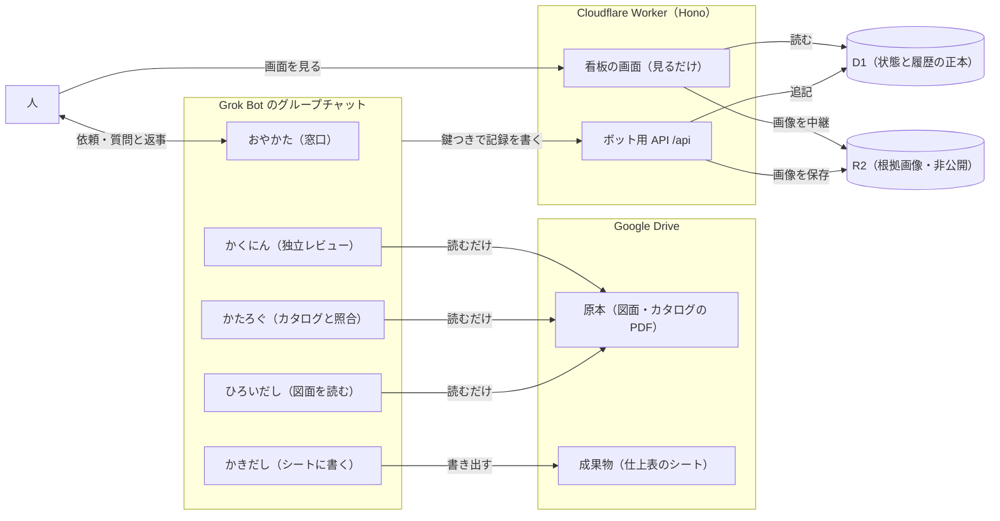
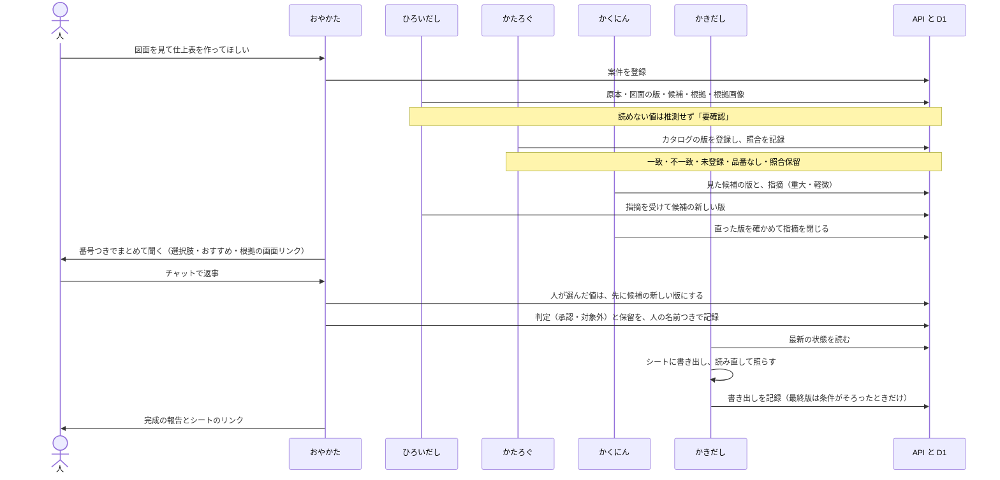

# システムの流れ

## ひとことで

図面から仕上げの候補を拾い、カタログと照らし、レビューして、人が決めたものだけを仕上表に書き出す仕組みです。考え方は一つです。作業はボットがし、決めるのは人です。決まりは DB が守り、すべての記録は追記だけで、上書きしません。5体の役割は [図面屋さん](team.md) にまとめています。

## 全体の構成

- ボットは API だけで書きます。DB を直接さわる Cloudflare の鍵は使いません。5体は同じクラウド環境で動きます。
- 原本は変えません。成果物のシートだけを Drive に書きます。
- 画面はログインなしの公開デモで、見るだけです。ブラウザで JavaScript は動きません。

## 1件の案件の流れ

人に聞くのは、レビューが済んでからの1回にまとめます。返事は人の名前つきで残りますが、本人確認はしていません。画面にもそう出ます。

## 候補の状態と看板の列

| 看板の列   | 入る状態             | 意味                 |
| ---------- | -------------------- | -------------------- |
| ボットの番 | 未レビュー、重大あり | ボットが作業中       |
| あなたの番 | 承認待ち、要確認     | おやかたが人に聞く   |
| 待ち       | 保留                 | 設計者などの回答待ち |
| 決定       | 承認済み、対象外     | 人が決めた           |

カードを人が動かす操作はありません。ボットが記録を足すと、状態が決まり、カードの列が変わります。たとえば、まだ判定も保留もない候補に、かくにんが重大な指摘を出すと「ボットの番」へ戻ります。直した版でその指摘が閉じると、ほかに止めるものがなければ「あなたの番」へ進みます。候補の版が変わると、前の版への承認は引き継ぎません。

画面は2つです。案件一覧と、案件ごとの看板です。看板の上には、決定の進み具合、最新の書き出し、段階の行（図面・候補・照合・レビュー・決定・書き出し）、最新の記録が出ます。候補に紐づかない指摘があれば、その知らせも出ます。カードを開くと、根拠画像・照合・レビュー・判定と保留・版の履歴が見られます。

## DB が止める決まり

決まりは D1 のトリガーと制約で止めます。API のつくりが変わっても、DB が通しません。

1. 承認の決まり
   - 判定は、候補の最新の版に対してだけできます。
   - 「要確認」の版は承認できません。
   - 重大な指摘が開いている候補は承認できません。
   - 保留中の候補は承認できません（対象外にはできます）。
   - かくにんが一度も見ていない候補は承認できません。
2. 書き出しの決まり。最終版は、候補が1件以上あり、すべての候補の最新の版が承認か対象外になり、保留と開いた重大な指摘（候補に紐づかない見落としも）がなくなり、読み直しの結果が「一致」のときだけ記録できます。書き出しは上書きせず、版が1つずつ上がります。
3. 照合の決まり。「一致」は、候補の品番とカタログの品番が文字どおり同じときだけです。
4. 図面の差し替えの決まり。改訂版で差し替えられるのは、同じ図面番号で、まだ差し替えられていない版だけです。1つの版は1回だけ差し替えられます。根拠のページは、図面のページ数を超えられません。
5. 追記だけ。一度書いた記録は直せず、消せません。直すときは、新しい版・指摘を閉じる行・保留を解除する行を足します。あとから変えられるのは、根拠画像を1回だけ足すこと、カタログの品番に廃番の印を付けること、判断パターンをやめる印を付けることだけです。

## 人とボットの分担

| だれ       | すること                                                                         |
| ---------- | -------------------------------------------------------------------------------- |
| 人         | チャットで依頼し、聞かれたことに答える。画面で進み具合を見る                     |
| おやかた   | 人との窓口。まとめて聞き、判定と保留を記録する。人の判断で指摘を閉じることもある |
| ひろいだし | 図面を読み、候補・根拠・根拠画像を入れる                                         |
| かたろぐ   | カタログを登録し、品番を照合する                                                 |
| かくにん   | 原本と根拠だけを見て独立にレビューし、指摘を出して閉じる                         |
| かきだし   | シートに書き出し、読み直して照らし、書き出しを記録する                           |
| システム   | 決まりに合わない記録を止める。すべてを追記で残し、画面に見せる                   |

## 割り切っていること

- 鍵は全ボットで1つです。どのボットかは `X-Bot` の申告で、役割ごとの制限は書き間違いを防ぐためのものです。本人確認ではありません。
- 人の判定は、チャットで受けた返事を、おやかたが名前つきで記録します。本人確認はしておらず、画面にもそう出します。
- 画面はログインなしの公開デモです。中身はすべて架空のデモのデータで、本物の図面や顧客の資料は入れません。
- 直した版のレビューをやり直すかは、おやかたの判断に任せています。DB では止めません。
